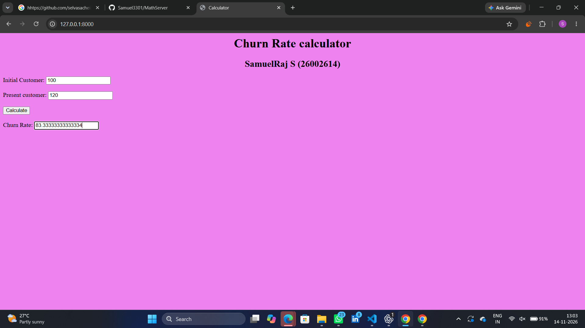

# Ex.03 Design a Website for Server Side Processing
## Date:14/11/2026

## AIM:
To create a web page to calculate Churn Rate using server-side scripts.

## FORMULA:
Churn Rate = (CustLost / InitCust) * 100
<br> InitCust --> Initial Customers Count
<br> CustLost --> Customers Lost Count

## DESIGN STEPS:

### Step 1:
Clone the repository from GitHub.

### Step 2:
Create Django Admin project.

### Step 3:
Create a New App under the Django Admin project.

### Step 4:
Create a HTML file to implement form based input and output.

### Step 5:
Create python programs for views and urls to perform server side processing.

### Step 6:
Receive input values from the form using request.POST.get().

### Step 7:
Calculate the Result using the given formula.

### Step 8:
Display the calculated result in the server console.

### Step 9:
Render the result to the HTML template.

### Step 10:
Publish the website in Localhost.

## PROGRAM:
```
math.py
<html>
    <head>
        <title>Calculator</title>
    </head>
<body bgcolor="violet">
<h1 align="center">Churn Rate calculator</h1> 
<h2 align="center">SamuelRaj S (26002614)</h2>

<form method="POST">
    
    <label>Initial Customer:</label>
    <input type="text" name="initialcust" value="{{c}}"><br><br>
    <label>Present customer:</label>
    <input type="text" name="custlost" value="{{n}}"><br><br>
    <input type="submit" value="Calculate"><br><br>
    <label>Churn Rate:</label>
    <input type="text" value="{{churn_rate}}"><br><br>
</form>

</body>
</html>

views.py
from django.shortcuts import render

def churn_rate(request):
    c = int(request.POST.get('initialcust', '0'))
    n= int(request.POST.get('custlost', '0'))

    churn_rate = (c /n) * 100 if request.method == 'POST' else 0

    print("initial_cust =", c)
    print("custlost =", n)
    print("churn_rate =", churn_rate)

    return render(
        request,
        'rajapp/math.html',
        {'initial_cust': c, 'custlost': n, 'churn_rate': churn_rate}
    )
urls.py
from django.contrib import admin
from django.urls import path
from rajapp import views

urlpatterns = [
    path('', views.churn_rate, name='churn_rate'),
]
```
## OUTPUT - SERVER SIDE:
.png>)


## OUTPUT - WEBPAGE:



## RESULT:
The the web page to calculate Churn Rate using server-side scripts is created successfully.
